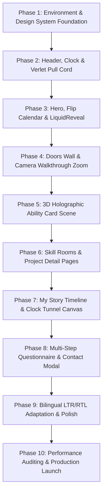

# IMPLEMENTATION_PLAN.md
# Comprehensive Phased Implementation Roadmap: Mazen Portfolio

This roadmap outlines the systematic, step-by-step engineering plan to recreate the portfolio faithfully for **Mazen**, specifying task dependencies, verification checkpoints, and strict acceptance criteria.

---

## 1. Phased Development Roadmap

---

### Phase 1: Environment & Design System Foundation
- **Objectives**: Initialize the Next.js 15+ project with TypeScript, Tailwind CSS v4, and the complete design token system from `therishithakor.com-design.md`.
- **Tasks**:
  1. Initialize Next.js with App Router, TypeScript, and Tailwind CSS.
  2. Configure fonts: Download and configure local WOFF2 files for `Onest`, `EB Garamond`, and Arabic font (`IBM Plex Sans Arabic` / `Readex Pro`).
  3. Set up `globals.css` with exact design tokens:
     - Colors: `--background (#E8E4E0)`, `--foreground (#1A1818)`, `--muted (#857878)`, `--line (#D5CDCA)`, `--surface (#DED8D4)`, etc.
     - Dark mode tokens: `[data-mode="dark"]` variables.
     - Spacing, border-radius pills (`9999px`), and custom easing curves (`--e-line`, `--e-spring`, `--e-soft`, `--e-snap`).
  4. Install and configure Lenis smooth scrolling provider with pause/resume controller.
- **Verification**: Base page renders with warm paper background, typography scales match Onest specifications, and dark mode toggles without layout shift.

---

### Phase 2: Header, Live Clock & Verlet Pull Cord
- **Objectives**: Implement the sticky header bar, dynamic local clock, and interactive Verlet integration rope simulation.
- **Tasks**:
  1. Build `Header.tsx`: Responsive layout with sticky positioning, blur backdrop on scroll, and navigation links.
  2. Implement `LiveClock.tsx`: Ticking local time display updating every second.
  3. Implement `PullCord.tsx`:
     - 26-node Verlet integration physics loop on a 2D `<canvas>`.
     - Pointer grab detection, downward spring extension constraints, and theme toggle trigger.
     - Natural gravitational pendulum settling animation.
- **Verification**: Dragging the cord down toggles the dark/light theme with smooth physics; releasing allows the rope to oscillate realistically.

---

### Phase 3: Hero Section, Flip Calendar & LiquidReveal Canvas
- **Objectives**: Build the asymmetric editorial hero, dynamic 3D desk-calendar, and dual-buffer LiquidReveal portrait.
- **Tasks**:
  1. Build `HeroSection.tsx`: Desktop and mobile responsive composition.
  2. Implement `FlipCalendar.tsx`:
     - Text width measurement for automatic spiral rings and hole count generation.
     - Web Animations API 3D flip animation (`rotateX(352deg)`) with brightness and shadow modulations.
     - Continuous 1.7s hold and 1.25s flip cycle.
  3. Implement `LiquidReveal.tsx`:
     - Dual-buffer canvas: Grayscale base + color target (`COLOUR_SRC`).
     - Radial brush stamp tracking pointer movement with alpha compositing (`lighter`).
     - Smooth idle decay loop dissolving back into grayscale.
  4. Mount `AbilityCardButton.tsx` trigger pill over portrait.
- **Verification**: Calendar flips smoothly without layout clipping; cursor movement over portrait paints color with seamless hair transparency.

---

### Phase 4: Interactive Doors Wall & Camera Walkthrough Zoom
- **Objectives**: Engineer the spring-hinged doors wall and the 60x exponential camera walkthrough zoom transition.
- **Tasks**:
  1. Build `DoorsWall.tsx` and `DoorUnit.tsx`:
     - Plaster textured wall layout with 4 visible doors + 1 secret photography door.
     - Semi-implicit Euler spring hinge: `tension: 120, friction: 14`.
     - Hover crack animation opening door by 7 degrees.
  2. Build `DoorCursor.tsx`: Floating cursor badge tracking pointer with zero lag.
  3. Build `DoorInfoCard.tsx`: Centered dynamic competency card.
  4. Implement `WallTransition.tsx` (Spatial Camera Zoom):
     - Calculates doorway opening coordinates and sets transform origin.
     - Drives per-frame exponential zoom up to 60x over 1500ms.
     - Freezes Lenis scroll during zoom.
     - Activates embedded room viewport `#wallv` without visual glitch.
     - Reverses zoom smoothly over 1300ms on exit.
- **Verification**: Hovering opens doors naturally; clicking executes continuous camera zoom directly through the doorway into the discipline room.

---

### Phase 5: 3D Holographic Ability Card Scene
- **Objectives**: Deliver the high-fidelity WebGL 3D trading card and pure CSS 3D fallback.
- **Tasks**:
  1. Build `HolographicModal.tsx`: Accessible dialog container with keyboard trap and ESC dismiss.
  2. Implement `AbilityCardScene.tsx`:
     - Three.js scene with custom GLSL shaders (frame specular glint, stencil window mask, flame/smoke billboards, gold backplate foil).
     - Pointer drag tracking with inertial rotation damping and front/back face snapping.
  3. Implement `AbilityCardFallback.tsx`: Pure CSS 3D transformed card for low-spec devices or WebGL failure.
- **Verification**: Card spins fluidly in 3D space with specular rainbow glare shifting across metallic contours; snaps to nearest face on release.

---

### Phase 6: Skill Rooms & Project Detail Pages
- **Objectives**: Create all 5 discipline rooms with stacked project cards and interactive media.
- **Tasks**:
  1. Implement room navigation header (`#rn`) with back-to-doors button and postMessage communication.
  2. Implement stacked project cards (`#stack`) for:
     - `/web-developer/`: Full-stack web projects with video demos.
     - `/app-developer/`: Mobile applications with device frames.
     - `/architecture/`: Software systems and cloud architecture case studies.
     - `/ui-ux-engineer/`: Design systems and interactive UI prototypes.
  3. Implement `/photographer/`: Infinite draggable photo gallery wall with 28 photos, blurred placeholders, and modal lightbox.
  4. Implement `/legal/`: Editorial privacy policy and credits.
- **Verification**: All sub-pages load standalone via direct URL and pre-render seamlessly within `#wallv` during doorway walkthroughs.

---

### Phase 7: "My Story" Timeline & Clock Tunnel Canvas
- **Objectives**: Build the 5-chapter experience timeline, central traveling dot rail, rolling odometer, and 3D clock tunnel.
- **Tasks**:
  1. Build `StorySection.tsx` and `StoryRail.tsx`: Central vertical line with glowing dot tracking viewport center.
  2. Implement `OdometerYear.tsx`: 4-column digit roll animating on chapter crossing.
  3. Implement `ClockTunnelCanvas.tsx`:
     - 2D canvas with 16 concentric 3D perspective rings, 60 radial clock ticks, and rotating hands.
     - Scroll-synchronized depth travel ($\text{camZ}$) and reverse dial spin ($\text{spin} = -p \cdot 1.5\pi$).
     - Depth-based fogging to ensure text legibility.
- **Verification**: Scrolling down moves deeper into the time tunnel; clock dials wind backward and year digits roll smoothly.

---

### Phase 8: Multi-Step Questionnaire & Contact Modal
- **Objectives**: Implement the 5-step client qualification questionnaire and Netlify/Server Action form.
- **Tasks**:
  1. Build `ContactModal.tsx` and `QuestionnaireForm.tsx`:
     - Step 1: Discipline selection with general inquiry gate.
     - Step 2: Budget selection with auto-detected currency (USD, GBP, INR, AED/SAR) and minimum scope gate.
     - Step 3: Timeline selection.
     - Step 4: Client type profile.
     - Step 5: Contact info and project brief validation.
  2. Implement progress indicator bar and back button navigation.
  3. Connect form submission to server endpoint with fallback to pre-filled `mailto:`.
- **Verification**: Form validates each step, gates unqualified inquiries politely, and submits data cleanly.

---

### Phase 9: Bilingual LTR/RTL Adaptation & Polish
- **Objectives**: Ensure full architectural parity for Arabic (RTL) mode.
- **Tasks**:
  1. Configure Next.js internationalized routing (`/[lang]/...`) and locale switching.
  2. Connect Arabic font (`IBM Plex Sans Arabic` / `Readex Pro`) with proportional font sizing.
  3. Mirror physical interactions:
     - Flip calendar leaf rotation and ring alignment.
     - Door hinge orientation and swing direction (`rotateY(-deg)`).
     - Verlet pull cord anchor placement.
     - Timeline rail and odometer positioning.
  4. Inject idiomatic, professionally crafted Arabic copy across all sections.
- **Verification**: Toggling language cleanly switches layout direction and typography; physical animations feel natural and intentional in both directions.

---

### Phase 10: Performance Auditing & Production Launch
- **Objectives**: Final optimization, accessibility compliance, and performance benchmarking.
- **Tasks**:
  1. Verify `.lite` mode behavior on simulated low-memory devices.
  2. Verify full accessibility (WCAG 2.1 AA keyboard navigation, ARIA live regions for doors and clock).
  3. Lighthouse audit: Target 95+ scores across Performance, Accessibility, Best Practices, and SEO.
  4. Cross-browser testing on Chrome, Safari, Firefox, Edge, and iOS/Android mobile devices.
- **Verification**: Site runs at consistent 60+ FPS on standard devices and passes all automated test suites.

---

## 2. Testing & Verification Strategy

### Automated Verification
- `npm run build`: Type-checking and bundle optimization.
- `npm run lint`: ESLint verification for React 19 standards.
- E2E Playwright tests verifying:
  - Theme toggling via pull-cord.
  - Door click walkthrough and sub-page iframe mounting.
  - Form step validation and submission.
  - Language switcher and RTL layout verification.

### Manual Verification Checklist
1. **Pull Cord**: Grabbing and releasing exhibits realistic Verlet pendulum physics; toggling theme updates all color tokens.
2. **Flip Calendar**: 3D page flip loops indefinitely; punched holes and rings adapt to skill word width.
3. **LiquidReveal**: Moving cursor over hero portrait reveals full-color layer with crisp hair edges; decays smoothly on idle.
4. **Doors Wall**: Hover cracks door open with spring damping; click scales wall 60x into doorway without white flash or layout jump.
5. **3D Card**: WebGL scene supports free 3D drag and auto-aligns to front/back face; fallback card works when WebGL is disabled.
6. **Timeline**: Scrolling through story chapters spins clock tunnel dials backward and rolls year digits smoothly.
7. **Bilingual Parity**: Arabic layout is 100% mirrored with native typography, correct door hinge swings, and polished copy.

