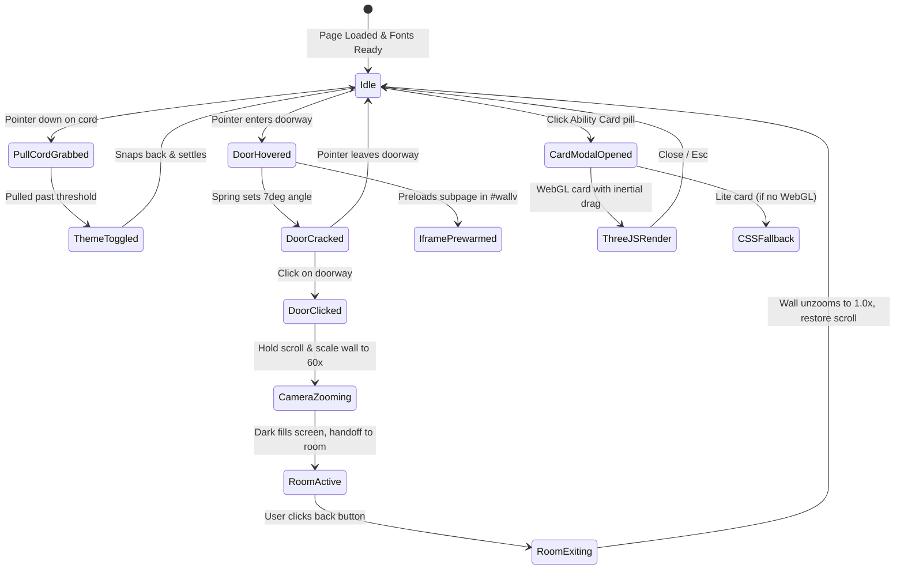

# TECHNICAL_SPECIFICATION.md
# Comprehensive Technical Architecture & Engineering Specification

This document outlines the complete technical architecture, library selection, directory structure, bilingual RTL mechanics, and performance optimization strategy for the faithful recreation of the portfolio for **Mazen**.

---

## 1. Core Technology Stack

| Layer | Recommended Technology | Justification vs. Alternatives |
| :--- | :--- | :--- |
| **Framework** | **Next.js 15+ (App Router)** | Excellent SSR/SSG for SEO, native internationalized routing (`/[lang]`), optimized font loading, and server action form handling. |
| **Language** | **TypeScript 5.x** | Strict type safety across physics vectors, animation states, shader uniforms, and bilingual dictionaries. |
| **UI Library** | **React 19** | Modern concurrent rendering, clean custom hook abstractions for RAF loops and spring physics. |
| **Styling** | **Tailwind CSS v4 + Custom Tokens** | Utility-first styling with comprehensive CSS variable tokens and first-class native CSS logical property support (`start`, `end`, `ms-`, `me-`). |
| **Smooth Scrolling** | **Lenis (latest bundle)** | Industry standard for decoupled, momentum-based smooth scrolling. Native pause/resume hooks for spatial zooms and modal focus. |
| **3D Engine** | **Three.js (WebGL)** | Dedicated strictly to the 3D Holographic Ability Card (`/ability-card/`). Stencil testing, multi-pass shaders, and postprocessing. |
| **Micro-Physics** | **Custom Vanilla JS/TS Hooks** | Semi-implicit Euler springs and Verlet integration implemented directly in TypeScript. Avoids bundle bloat and matches the reference site's exact physics formulas. |
| **Animation Engine** | **Web Animations API + RAF** | Used for the flip-calendar and canvas rendering loops. Ensures optimal 60/120 FPS hardware acceleration. |

---

## 2. Directory & Component Architecture

```
portfolio/
├── app/
│   ├── [lang]/
│   │   ├── layout.tsx             # Root bilingual layout (sets dir="ltr"|"rtl", loads Onest & Arabic font)
│   │   ├── page.tsx               # Main Home Page (Hero, Doors, Story, Contact)
│   │   ├── web-developer/
│   │   │   └── page.tsx           # Full-Stack Web Projects Room
│   │   ├── app-developer/
│   │   │   └── page.tsx           # Mobile Applications Room
│   │   ├── architecture/
│   │   │   └── page.tsx           # Systems & Cloud Architecture Room
│   │   ├── ui-ux-engineer/
│   │   │   └── page.tsx           # UI Engineering & Design Systems Room
│   │   ├── photographer/
│   │   │   └── page.tsx           # Photography & Visual Gallery Room
│   │   ├── ability-card/
│   │   │   └── page.tsx           # 3D WebGL Holographic Ability Card View
│   │   └── legal/
│   │       └── page.tsx           # Legal & Privacy Policy
│   ├── api/
│   │   └── contact/
│   │       └── route.ts           # Contact form submission endpoint
│   └── globals.css                # Global tokens, reset, typography, and utility classes
├── components/
│   ├── common/
│   │   ├── Header.tsx             # Sticky header with clock, language switcher & menu button
│   │   ├── PullCord.tsx           # Verlet rope simulation canvas for dark/light toggle
│   │   ├── LiveClock.tsx          # Real-time local time indicator
│   │   ├── PageLoader.tsx         # Initial load reveal screen
│   │   ├── FullscreenListener.tsx # 'F' key toggle handler
│   │   └── CookieConsent.tsx      # Privacy gate banner
│   ├── hero/
│   │   ├── HeroSection.tsx        # Hero grid container
│   │   ├── FlipCalendar.tsx       # 3D Desk-calendar skill flipper with dynamic wire rings
│   │   ├── LiquidReveal.tsx       # Dual-buffer canvas cursor-trail reveal portrait
│   │   └── AbilityCardButton.tsx  # Interactive trigger pill
│   ├── ability-card/
│   │   ├── HolographicModal.tsx   # Dialog overlay wrapper & focus trap
│   │   ├── AbilityCardScene.tsx   # Three.js WebGL canvas with custom shaders
│   │   └── AbilityCardFallback.tsx# Pure CSS 3D fallback card for low-spec devices
│   ├── doors/
│   │   ├── DoorsWall.tsx          # Continuous textured wall container & scroll observer
│   │   ├── DoorUnit.tsx           # Individual spring-hinged door with brass plate & handle
│   │   ├── DoorCursor.tsx         # Custom cursor pill following pointer
│   │   ├── DoorInfoCard.tsx       # Centered dynamic description card
│   │   └── WallTransition.tsx     # 60x exponential camera walkthrough zoom coordinator
│   ├── story/
│   │   ├── StorySection.tsx       # Timeline container
│   │   ├── StoryRail.tsx          # Central vertical line and synchronized glowing dot
│   │   ├── OdometerYear.tsx       # Rolling digit 4-digit odometer counter
│   │   └── ClockTunnelCanvas.tsx  # 3D perspective time-travel clock canvas
│   └── contact/
│       ├── ContactModal.tsx       # Modal sheet container
│       ├── QuestionnaireForm.tsx  # 5-step questionnaire with conditional logic & gating
│       └── Footer.tsx             # Footer links, social handles, copyright
├── hooks/
│   ├── useLenis.ts                # Smooth scroll lifecycle & lock/unlock controller
│   ├── useEulerSpring.ts          # Semi-implicit Euler physics hook
│   ├── useVerletRope.ts           # 26-node Verlet rope physics hook
│   ├── useDeviceCapability.ts     # Device memory, concurrency & low-power detection
│   └── useDictionary.ts           # Strongly-typed i18n copy provider
├── lib/
│   ├── tokens.ts                  # Design system color and typography constants
│   ├── shaders/                   # GLSL shader strings for the 3D card
│   └── dictionary/                # English and Arabic translation dictionaries
└── public/
    ├── fonts/                     # Onest, EB Garamond, IBM Plex Sans Arabic WOFF2 files
    ├── card/                      # 3D card textures and fallback WebP assets
    └── projects/                  # Mazen's software engineering screenshots and MP4s
```

---

## 3. Bilingual & RTL Architecture

Supporting Arabic as a first-class citizen requires far more than setting `direction: rtl`. Physical interactions and spatial animations must feel intrinsically native in both directions.

### 3.1 Layout Direction & Typography
- **HTML Attribute**: `<html lang={lang} dir={lang === 'ar' ? 'rtl' : 'ltr'}>`.
- **Font Stack Switching**:
  - `en`: `'Onest', ui-sans-serif, system-ui, sans-serif`
  - `ar`: `'IBM Plex Sans Arabic', 'Readex Pro', sans-serif`
- **Tailwind Logical Properties**:
  - Replace `left-*` and `right-*` with `start-*` and `end-*`.
  - Replace `ml-*` and `mr-*` with `ms-*` and `me-*`.
  - Replace `pl-*` and `pr-*` with `ps-*` and `pe-*`.
  - Borders: `border-s`, `border-e`.

### 3.2 Directional & Mechanical Mirrored Physics

| Component | English (LTR) Behavior | Arabic (RTL) Behavior |
| :--- | :--- | :--- |
| **Desk-Calendar Flip** | Rings along top edge; counter reads left-to-right (`01 / 05`). | Rings along top edge; counter formatted right-to-left (`٠١ / ٠٥` or `01 / 05`). Leaf flips cleanly without skewing text. |
| **Verlet Pull Cord** | Anchored on the right side of the header beside the clock. | Anchored on the left side of the header beside the mirrored clock, preserving visual balance. |
| **Interactive Doors Wall** | Doors indexed 0 to 4 from left to right; secret door hidden on far right. | Doors indexed 0 to 4 from right to left; secret door hidden on far left. |
| **Door Swing Perspective** | Door hinges mounted on left jamb, swinging inward to the left: `rotateY(deg)`. | Door hinges mounted on right jamb, swinging inward to the right: `rotateY(-deg)`. |
| **Walkthrough Camera Zoom** | Coordinates calculated relative to door gap on the right. | Coordinates calculated relative to door gap on the left, scaling smoothly to center. |
| **My Story Timeline** | Rail positioned to the left of chapter copy; year counter to the left. | Rail positioned to the right of chapter copy; year counter to the right. |
| **Clock Tunnel Canvas** | Dials spin counter-clockwise as time moves backward: `spin = -p * PI * 1.5`. | Dials spin in harmony with RTL visual progression. |
| **Questionnaire Progress** | Progress bar fills from left to right ($0\% \to 100\%$). | Progress bar fills from right to left ($0\% \to 100\%$). |

---

## 4. State Management & Interaction Pipeline



---

## 5. Performance & Rendering Strategy

1. **GPU Promotion**:
   - Elements participating in transforms (`.doors__wall`, `.unit`, `.cal__leaf`, `.cord__cv`) are explicitly promoted via `will-change: transform` and `transform: translateZ(0)`.
2. **Decoupled Scroll & Rendering**:
   - Lenis handles window momentum.
   - Heavy visual updates (Clock Tunnel, LiquidReveal) execute inside isolated `requestAnimationFrame` ticks without blocking the main browser layout thread.
3. **Canvas Pixel Ratio Clamping**:
   - All 2D and WebGL canvases clamp resolution to `Math.min(window.devicePixelRatio || 1, 2)`. This prevents 3x or 4x retina displays (e.g. iPhone Pro / 4K displays) from incurring massive fill-rate performance penalties.
4. **Adaptive Tiering (`.lite`)**:
   - If `navigator.deviceMemory <= 2` or `navigator.hardwareConcurrency <= 2` or `connection.saveData`, the root element receives `.lite`.
   - In `.lite` mode:
     - LiquidReveal canvas is omitted; clean grayscale portrait is served directly.
     - 3D Clock Tunnel canvas is replaced with a refined static radial gradient.
     - Holographic card loads the CSS 3D fallback directly instead of spinning up the Three.js WebGL engine.

